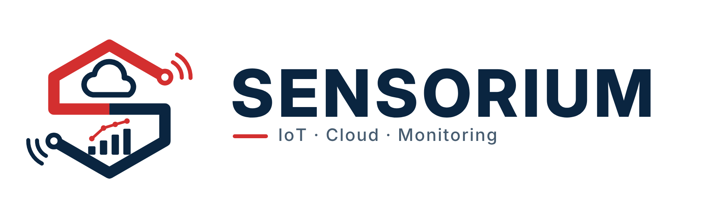

<picture>
  <source media="(prefers-color-scheme: dark)" srcset="sensorium-banner-dark.png">
  
</picture>

# Sensorium

Projet **Cloud et IoT** du Master 2 : supervision de capteurs connectés avec ThingsBoard, déployé sur une infrastructure OpenStack.

## Nos dépôts

Pas encore de dépots.

## Équipe

- VENAULT Baptiste
- SAHRAOUI Sofianne
- MEZEMATE Hichem
- MENDIL AMINE